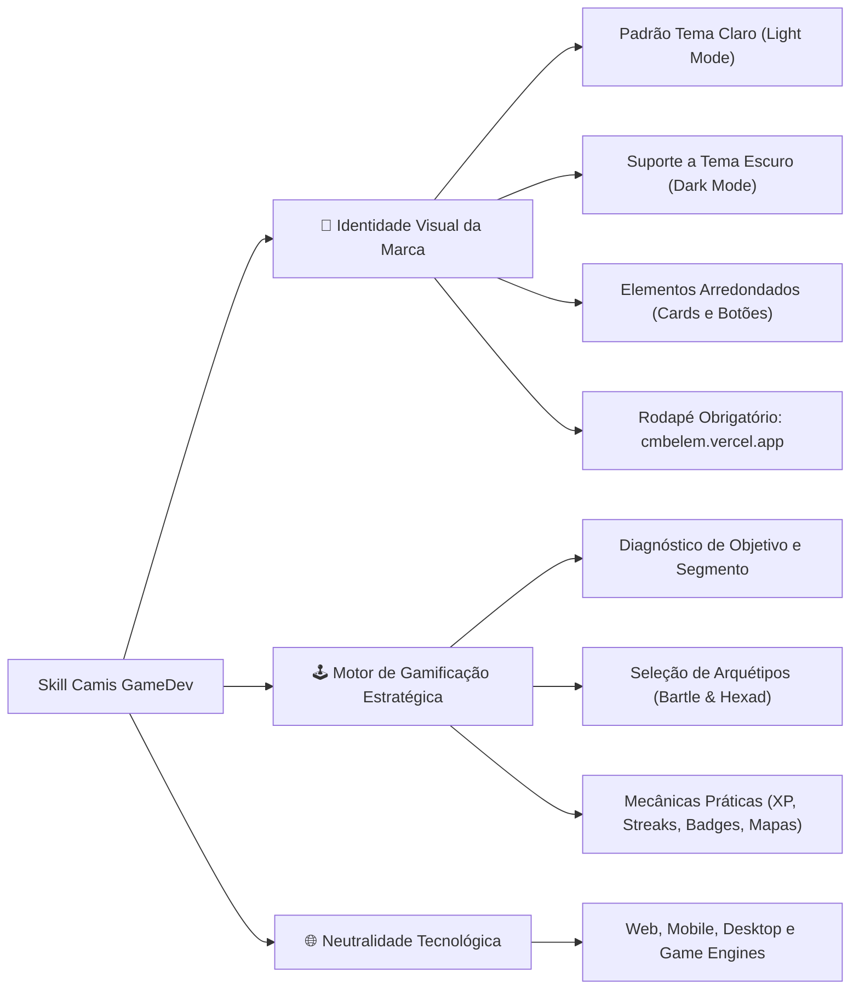

# 🎮 Camis GameDev - AI Brand Identity & Gamification Skill

Skill oficial de **Identidade Visual, Design System e Motor de Gamificação Estratégica** da **Camis GameDev** para desenvolvimento de projetos pessoais.

O grande diferencial desta skill é unir a solidez e rigor de **Engenharia de Software Real** com o poder de engajamento do **Game Design**, transformando sistemas e aplicações comuns em experiências imersivas, motivadoras e de alta retenção de usuários.

A skill é **100% agnóstica a linguagem de programação, framework ou plataforma** (funciona com React, Next.js, Vue, Svelte, Angular, Flutter, React Native, Unity, Godot, HTML/CSS puro, Node.js, Python, etc.).

---

## 🌟 Pilares da Skill



---

## 🎨 1. Identidade Visual da Marca

A identidade visual da Camis GameDev é estruturada em torno de 3 temas principais e diretrizes de design consistentes:

### ☀️ Padrão: Tema Claro (Light Mode)
* **Padrão Obrigatório:** Todas as interfaces adotam o **Tema Claro** por padrão, priorizando clareza, luminosidade suave e alto contraste tipográfico para acessibilidade.
* **Tema Escuro (Dark Mode):** Suportado como alternância (toggle) ou especificação complementar para ambientes noturnos.

### 🔘 Elementos Sempre Arredondados
* **Botões:** Bordas bem arredondadas (estilo *pill* `border-radius: 9999px` ou `16px` a `24px`).
* **Cards e Contêineres:** Cantos arredondados generosos (`border-radius: 16px` a `24px` / squircle), criando uma estética amigável, moderna e tátil.

### 🔗 Assinatura Oficial no Rodapé
Todas as aplicações, landing pages e telas desenvolvidas incluem obrigatoriamente a assinatura oficial no rodapé:
```text
Desenvolvido por Camis GameDev (http://cmbelem.vercel.app/)
```

### 🎭 Comparativo Objetivo dos 3 Temas

| Tema | Foco & Trilha | Paleta Principal | Sensação & Estilo | Indicação de Uso |
| :--- | :--- | :--- | :--- | :--- |
| 🔹 **Dark Blue / Neon Blue** | Unity 3D & Engenharia Sênior | Slate (`#0F172A`), Unity Blue (`#2563EB`), Sky/Neon (`#38BDF8`) | Técnico, analítico, alta performance, futurista | Dashboards, ferramentas dev, simuladores, softwares de engenharia |
| 🔺 **Roblox Crimson** | Roblox Studio & Luau | Roblox Red (`#E11D48`), Crimson (`#BE123C`), Soft Rose (`#FB7185`) | Dinâmico, energético, gamificado, juvenil | Jogos casuais, comunidades, apps sociais, público jovem |
| 🔸 **Scratch Orange** | Alfabetização Digital & Lógica | Scratch Orange (`#EA580C`), Bright Orange (`#F97316`), Yellow (`#FDE047`) | Acolhedor, pedagógico, blocos contrastantes | EdTechs, apps de aprendizagem infantil e tutoriais |

---

## 🕹️ 2. Motor de Gamificação (O Grande Diferencial)

A gamificação da skill é baseada na psicologia comportamental (autodeterminação, feedback de dopamina e ciclos de recompensa contínua), utilizando o acervo prático da pasta `gamificação/` (estudos de caso de apps como **Duolingo**, **Habitica**, **Forest**, **Strava**, **Drops**, **FitOn** e **Waze**).

### 🔄 Fluxo de Descoberta Obrigatório

Antes de escrever qualquer linha de código ou layout, a skill realiza as seguintes perguntas essenciais:

```
1️⃣ Qual é o OBJETIVO do sistema/produto?
   (Ex.: retenção diária, combater procrastinação, ensinar uma habilidade, engajar comunidade)

2️⃣ Qual é o SEGMENTO de mercado?
   (Ex.: Educação, Produtividade, Saúde/Fitness, Finanças, E-commerce, Jogos)

3️⃣ Quais ARQUÉTIPOS de jogadores guiarão a experiência?
```

### 🧠 Arquétipos de Usuários (Modelos de Bartle & Hexad)

* 🏆 **Conquistadores / Realizadores (Achievers):** Motivados por metas, maestria e progresso visível.  
  * *Mecânicas recomendadas:* Barras de XP, níveis, badges de conquistas raras, medalhas.
* 🧭 **Exploradores / Espíritos Livres (Explorers / Free Spirits):** Motivados por curiosidade, autonomia e autoexpressão.  
  * *Mecânicas recomendadas:* Mapas de fases não-lineares, personalização de visual, easter eggs, áreas secretas.
* 🤝 **Socializadores (Socializers):** Motivados por conexão humana e cooperação.  
  * *Mecânicas recomendadas:* Equipes/guildas, envio de vidas/recursos para amigos, desafios colaborativos.
* ⚔️ **Competidores / Predadores (Killers):** Motivados por duelos diretos, superação dos outros e status.  
  * *Mecânicas recomendadas:* Ligas semanais (ouro, diamante), leaderboards dinâmicos, rankings ao vivo.
* 🎁 **Jogadores (Players):** Motivados por recompensas extrínsecas tangíveis.  
  * *Mecânicas recomendadas:* Moedas in-app, baús diários, lojas de itens virtuais ou cupons reais.
* 💖 **Filantropos (Philanthropists):** Motivados por propósito nobre e altruísmo.  
  * *Mecânicas recomendadas:* Doação de recursos, mentoria de novatos, impacto social do uso da ferramenta.
* ⚡ **Disruptores (Disruptors):** Motivados por desafiar limites e transformar o sistema.  
  * *Mecânicas recomendadas:* Votação de features, criação de conteúdo pela comunidade, personalização avançada.

---

## 🌐 3. Agnosticismo Tecnológico

A skill pode ser utilizada para construir soluções em qualquer linguagem ou tecnologia:

* **Web Front-end:** React, Next.js, Vue, Svelte, Angular, HTML5/CSS3 (com Tailwind, CSS Modules, Styled-Components).
* **Mobile:** Flutter, React Native, Swift (iOS), Kotlin (Android).
* **Game Development:** Unity (C# / UI Toolkit), Godot (GDScript / UI Nodes), Roblox Studio (Luau).
* **Back-end & Dados:** Regras de negócio de gamificação, APIs REST/GraphQL, cálculo de XP e streaks em Node.js, Python, Go, C#, PostgreSQL, Supabase ou Firebase.
* **Design Systems:** Design tokens em formato JSON, CSS Custom Properties ou documentação para Figma.

---

## 📂 Estrutura do Repositório

```text
📁 cami-brand-identity-skill/
├── 📄 README.md              <- Documentação completa e guia de uso
├── 📄 SKILL.md               <- Motor e System Prompt executável pela IA
├── 📁 assets/                <- Identidade visual oficial da Camis GameDev
│   ├── 📁 LOGOTIPO/          <- Variações oficiais da logo
│   ├── 📁 SÍMBOLOS/          <- Ícones e selos (+, colchetes, estrelas, x)
│   ├── 📁 FONT/              <- Tipografia da marca
│   └── 📁 ...                <- Mockups, padrões e capas
└── 📁 gamificação/           <- Acervo teórico e referências visuais
    ├── 📄 arquetipos.pdf     <- Modelos de Bartle e Hexad detalhados
    ├── 📄 definição.pdf      <- Tríade de Werbach & Hunter e aplicações reais
    ├── 📄 apps_exemplo.pdf   <- Estudos de caso (Duolingo, Habitica, Strava, etc.)
    ├── 📄 O guia definitivo...pdf <- Retenção, loops de dopamina e mecânicas
    └── 🖼️ elementos_*.png    <- Referências visuais de UI gamificada (mapas, moedas, badges)
```

---

## 🚀 Como Utilizar nos seus Projetos Pessoais

### Opção 1: Como Submódulo Git (Recomendado)
Para vincular a skill a qualquer novo projeto e receber atualizações automáticas:
```bash
git submodule add https://github.com/marquesbelem/cami-brand-identity-skill.git .agent/skills/cami-brand-identity
```

### Opção 2: Clonando na pasta de Skills do Agente
```bash
# Na raiz do seu projeto:
mkdir -p .agent/skills
git clone https://github.com/marquesbelem/cami-brand-identity-skill.git .agent/skills/cami-brand-identity
```

### Ativação Automática no seu Projeto
Crie ou edite o arquivo `.agent/rules` (ou `.rules`) do seu projeto e adicione:
```text
Sempre que solicitado o desenvolvimento de interfaces, sistemas, mecânicas ou componentes para projetos pessoais da "Camis GameDev", siga estritamente as diretrizes de identidade visual e gamificação definidas em:
.agent/skills/cami-brand-identity/SKILL.md
```

### Exemplos de Prompts para o Agente
> *"Estou criando um app de organização diária em Flutter. Utilize a skill da Camis GameDev para definir o onboarding de gamificação e o visual no Tema 1."*

> *"Quero criar um jogo educativo em Godot. Aplique a identidade visual da Camis GameDev e sugira as mecânicas de gamificação para o arquétipo Conquistador."*

> *"Gere um componente de card de progresso em React com Tailwind, seguindo os botões e cards arredondados da marca, no tema claro com o rodapé oficial."*
